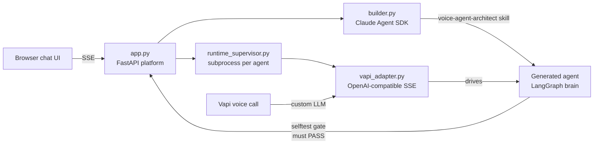

# Alta Agent Studio — Voice Agent Builder

Chat with an **AI builder** that designs, generates, and tests a complete
**voice AI agent** from a plain-language description. The generated agent runs
as its own LangGraph project, talks over a real phone/web call (Vapi),
qualifies leads, and books meetings. Ask for a change in chat
("also ask about budget") and the builder edits the agent, re-proves it with an
automated selftest, and the very next call reflects the change.

The deliverable is the **builder platform** — every agent it produces is a
standalone, provider-agnostic Python project you can download as a zip.

## Architecture



- **Builder** (Claude Agent SDK): designs the agent with you, writes only the
  domain surfaces of a tested boilerplate, and gates every build/edit on a
  deterministic selftest.
- **Generated agent**: a full LangGraph project — intent/answer/enrich model
  tiers, RAG, tools — bound to no LLM vendor (any OpenAI-compatible `/v1`
  endpoint via env).
- **Voice runtime**: streams the agent's replies to Vapi with latency cover
  (filler phrases, sentence chunking, pre-TTS sanitizer).

## Setup — 3 steps

1. **Launch**: `run.bat` (Windows) or `./run.sh` (macOS/Linux). It creates a
   venv, installs `requirements.txt`, seeds `.env`, and starts the server.
2. **Open** http://localhost:8100 and enter your keys in the setup screen:
   your **Anthropic API key** (or one click to use this machine's Claude
   subscription login) and an **OpenAI API key** for the generated agent's
   voice brain. That's the whole setup — keys are stored only in the local
   `.env`.
3. **Build & call**: describe the agent you want, approve the design, wait for
   the selftest to pass (the orb lights up), then click **Call agent** and talk
   to it.

> **A note on safety**: voice transport (Vapi) ships pre-configured with
> deliberately scoped, restricted demo credentials so you don't need a Vapi
> account. Your own keys never leave this machine, and you can disconnect at
> any time from the top bar. All required variables are documented in
> [.env.example](.env.example).

## Verify

```bash
python -m pytest builder_platform/tests/   # platform suite
```

Every generated agent also ships its own `selftest.py`; the builder runs it
automatically after each generation or edit and refuses to serve an agent that
hasn't passed.

More detail: [SETUP.md](SETUP.md) · project rules: [CLAUDE.md](CLAUDE.md)
