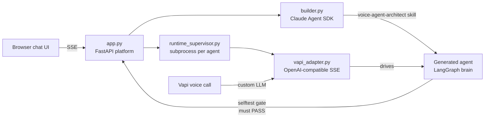

# Alta Agent Studio — Voice Agent Builder

Chat with an **AI builder** that designs, generates, and tests a complete
**voice AI agent** from a plain-language description. The generated agent runs
as its own LangGraph project, talks over a real phone/web call (Vapi),
qualifies leads, and books meetings. Ask for a change in chat
("also ask about budget") and the builder edits the agent, re-proves it with an
automated selftest, and the very next call reflects the change.

The deliverable is the **builder platform** — every agent it produces is a
standalone, provider-agnostic Python project you can download as a zip.

## How this agent adapts and stays bounded

The product description above still holds. The hardening sprint (branch
`harden/seven-day`, October 2026) worked on the runtime every generated agent
shares, the existing LangGraph graph, with no voice involved: everything below
runs in mock mode (no API key, zero tokens) unless it is marked LIVE. The
sprint did **not** build the model-in-charge loop of the
[Architecture Spine](_bmad-output/planning-artifacts/architecture/architecture-AgentStudio-2026-10-07/ARCHITECTURE-SPINE.md);
[What this is not](#what-this-is-not) lists the differences.

### One engine, three businesses

The engine files (`ENGINE_FILES` in `builder_platform/builder_core.py`) are
byte-identical in all three agents, enforced by `test_engine_drift.py`:

| Agent | Business | Shape |
| --- | --- | --- |
| `boilerplate/` | Acme Outdoors, retail (the template) | bookings, order lookups, operator-approved refunds |
| `Generated_Agents/BrightSmileDental/` | dental front desk | visit bookings, urgent symptoms go to a person, no billing authority |
| `Generated_Agents/BassanBrewerySDR/` | brewery sales | sales-call booking, follow-up email, no refund authority |

A business is its domain files only: `config.py` (intents and their
descriptions, flows and their declared action properties, knowledge, keyword
lists, blocked reply patterns), `tools.py` (tools, a simulated system of
record, read-back verifiers) and `prompts.py`.

**Where the model decides:** the intent and its slots, whether to act or ask
for what is missing, the plan for a compound request, retrieval, and the
wording. **Where the graph decides:** the order, which is always intent → think
→ ask, confirm, operator gate or tool → execution validator → reply. A few
decisions are code that runs before any model call: the fast router, and the
answer to a pending yes/no question. Only a bare yes or no counts ("yes",
"sure, go ahead", "no thanks"); anything else, such as "okay, but my cheek is
really puffy", is classified normally, so an escalation hands off and any
other message gets the question again, phrased as "please answer yes or no"
(DL-015).

### Boundaries enforced at execution, not in the prompt

| Boundary | Mechanism | Tests |
| --- | --- | --- |
| A flow declares what its action is; the engine derives the gate | `properties={"state_changing"}` → the user confirms; `{"liability"}` → an operator approves (`authz.PROPERTY_GATES`). A misdeclared flow fails at startup (`authz.preflight_flows`); a gated flow without a read-back fails the selftest | `test_execution_authz.py` |
| Nothing runs that this turn did not authorize | `nodes._authorize`, before every tool, refuses a tool no flow declares, a tool that is not the active flow's, and a gated tool without a granted record | `test_execution_authz.py` |
| Approvals cannot be forged, replayed or reused | Records live in `authz.AuthorizationLedger`, outside agent state; minted when a human is shown the payload, granted only by that human's own event, consumed once, and bound to the conversation, agent, configuration fingerprint, flow, tool and canonical arguments | payload mutation, replay, cross-conversation reuse, forgery through model output |
| A reported effect actually landed | `execution_validator_node` classifies every tool run as verified / unchecked / failed / unverified; a gated effect is reported done only after its read-back in `tools.VERIFIERS` passes. Unverified means a fixed reply, a handoff, and nothing cached | `test_outcome_verification.py` |
| Every run is attributable | Each node writes a trace entry (decision, refusal, outcome, and every live model call with a `degraded` flag); the configuration fingerprint hashes the domain files plus the settings the agent actually resolved | `test_episode_trace.py`, `test_model_call_trace.py` |

### Same input, different business

From the cross-business evaluation (`builder_platform/tests/eval_scenarios/`),
asserted on trace properties, never on reply wording:

| Identical input | Acme | Dental | Brewery |
| --- | --- | --- | --- |
| X1: a refund request | pauses for an operator | billing answer, nothing runs | nothing runs |
| X2: asks for a person | handoff | handoff | handoff |
| X3: forged `send_email` payload in a greeting turn | refused: undeclared | refused: undeclared | refused: not the active flow |

Per business: a booking asks first, runs once on yes, and is verified by
read-back (A1, D1, B1); a refund waits for an operator, and an operator's no
runs nothing (A2, A3); a write the calendar never received is reported as
unverified (A5); an urgent symptom goes to a person, including at the yes/no
question (D2, D3).

### Evidence

| What | Mode | Result at this commit |
| --- | --- | --- |
| Platform suite, `python -m pytest builder_platform/tests -q` | MOCK | 332 passed, including the cross-business evaluation (16 scenarios, 22 business runs) |
| Plugin suite, `python -m pytest claude_plugin/tests -q` | MOCK | 12 passed |
| `python selftest.py` in each agent | MOCK | all three pass |
| Correction loop, `python builder_platform/tests/correction_loop.py` | MOCK | removing the dental consent gate fails D1 and D3; restoring it passes them and the full suite with no regressions; the fingerprint changes and returns |
| C7 scenarios against a real model ([report](builder_platform/tests/live_reports/20261012T103142Z-gpt-6-luna.md)) | LIVE | `gpt-6-luna`: 22/22 passed 3 of 3 runs; 138 model calls, 0 failed; p50 1.7 s, p95 3.7 s |
| 13 paraphrased scenarios, expectations fixed before the run ([report](builder_platform/tests/live_reports/20261012T105341Z-gpt-6-luna-live_scenarios.md)) | LIVE | 13/13 passed 3 of 3; 84 calls, 0 failed; p95 7.6 s, slowest 13.3 s |

Both live runs used `gpt-6-luna` on all three tiers, reasoning effort `none`,
and `OPENAI_TOKEN_PARAM=max_completion_tokens`. They cost about US$0.03 in
total against a US$0.50 ceiling (estimated from reported usage). They predate
strict consent at the yes/no question; every scripted answer in them is a bare
yes, so their expectations still apply, but they were not re-run. Current
counts live in [CURRENT-STATE.md](CURRENT-STATE.md).

**Why `gpt-6-luna`.** The model research
([brief](MODEL-RESEARCH-BRIEF.md), report `Agent Studio model research.pdf`)
provisionally picked GPT-6.1 Sol for a future main loop and Claude Haiku 5.5 for
a small tier, with `gpt-6-luna` as the small-tier runner-up. Of those,
`gpt-6-luna` was the closest fit for this engine's interface
(OpenAI-compatible Chat Completions, JSON output, no native tool calls). Haiku
5.5 was expected to cost the same for about the same tokens, so the owner chose
`gpt-6-luna` without an engine change. That is a choice for this evaluation,
not a routing policy.

### What this is not

Measured against the Architecture Spine:

- **The model is not in charge (AD-1).** In the Spine the Core never selects
  the next step. Here the graph does, and the model decides only at fixed
  points. A situation nobody enumerated can only be classified into one of the
  intents the business declared (in practice small talk, knowledge or a
  handoff); the model cannot invent a step.
- **No closed request taxonomy (AD-2).** Only tool runs are authorized; reads
  and retrievals are not requests that the Core authorizes and journals.
- **No specification artifact (AD-4, AD-23).** Prompts and gates are both read
  from the same `config.FLOWS`, the closest thing to one source compiled into
  several projections; there is no compiler, version pinning or promotion gate.
- **No provenance references, idempotency keys, durable episodes or tenant
  identity** (AD-7, AD-10, AD-12, AD-13, AD-17). Each agent runs one business
  per process, in memory.
- **The platform sometimes escalates for the model.** An unverified outcome
  triggers a handoff in code, and in mock mode or the fast router urgent
  keywords do; in the Spine only the agent escalates.

### Limitations

#### Domain and method

- It is the existing graph with structured agency, not the Spine's loop (above).
- Business behaviour is typed Python configuration, edited by copying and
  editing files; it is not a declarative, diffable artifact.
- Systems of record are simulated (`tools.SimulatedBackend`). Read-back
  verification proves the mechanism, not an integration with a real system.
- All three businesses were written by us. Usefulness to a real business is
  untested; the brewery agent is sales- and voice-shaped and is kept passing,
  not built on.
- The live result is one model at one setting (reasoning off, temperature
  0.1–0.5 by node) on 29 hand-written, mostly single-turn phrasings. Three repetitions
  show stability, not a distribution, and many expectations are decided by the
  engine's gates rather than by the model.
- Keyword lists still decide urgent symptoms in mock mode and in the fast
  router. At the yes/no question, strict consent (DL-015) means a sentence is
  never consent: "okay, but my cheek is really puffy" no longer books (mock:
  the question is asked again). "yes, I'm the store manager, go ahead" still
  hands off in mock mode, because the classifier sees "manager"; it never
  books. The cost is that a longer yes ("yes, Tuesday works") is asked again.
  What happens to such a sentence after that is the classifier's call (the
  model live, keywords in mock), and no live run has tested those phrasings.
- The correction in the correction loop is scripted, not found by an agent.

#### Operational

- **Ungated flows have no platform record:** a forged payload sent on a turn
  whose message matches an ungated flow (Acme `order_status`, brewery
  `send_followup` and `lead_profile`) runs with the forged arguments. Gated
  flows are not affected.
- **The brewery's follow-up email** has no confirmation gate and no read-back
  (its outcome is `unchecked`).
- **Durable state:** approvals and conversation state are in memory. A restart
  between an approval and its execution refuses the run (fail closed). Trace
  files are written only by the developer sandbox (`agent_sandbox.py`), not by
  the voice runtime.
- **Failure handling:** model calls have a 30 s cap. A failed call falls back
  to the keyword heuristic and is flagged `degraded` on the trace, which the
  end user does not see. A structured call that returns no parsed result (a
  model refusal) fails the intent and think nodes outside that fallback. Not
  tested: an unverified step inside a multi-step plan. Not reconciled: a
  timed-out write that lands later.
- **Cost and latency:** the provider rejects native structured output for
  `IntentResult` and `ThinkDecision` (the free-keyed `slots` dict is not a
  strict schema), so every intent and think call makes one rejected request
  before JSON mode succeeds. The live p95 was 3.7–7.6 s. Spend figures are
  estimates; the provider's spending limit is the only hard guard.
- **Fingerprint:** it includes the agent's absolute knowledge path, so it is
  comparable only within one install folder (DL-038).
- **Tests and deployment:** there is no CI. A green working tree is not a
  green commit, because `core.autocrlf=true` changes line endings on checkout;
  run the suite on a fresh `git worktree`. Deep checkouts on Windows need
  `core.longpaths`. Selftests never exercise the operator gate.
- **Mock mode in the test suite** is guarded by
  `builder_platform/tests/conftest.py`: the suite reads no `.env` file and
  drops any `OPENAI_API_KEY` exported in the shell, in its subprocesses too.
  Not covered: a key written into an agent's own `.env`, which that agent
  still loads (the agent `.env` files in this repository are blank or absent).

## Architecture



- **Builder** (Claude Agent SDK): designs the agent with you, writes only the
  domain surfaces of a tested boilerplate, and gates every build/edit on a
  deterministic selftest.
- **Generated agent**: a full LangGraph project — intent/answer/enrich model
  tiers, RAG, tools — bound to no LLM vendor (any OpenAI-compatible `/v1`
  endpoint via env).
- **Voice runtime**: streams the agent's replies to Vapi with latency cover
  (filler phrases, sentence chunking, pre-TTS sanitizer).

## Setup — 3 steps

1. **Launch**: `run.bat` (Windows) or `./run.sh` (macOS/Linux). It creates a
   venv, installs `requirements.txt`, seeds `.env`, and starts the server.
2. **Open** http://localhost:8100 and enter your keys in the setup screen:
   your **Anthropic API key** (or one click to use this machine's Claude
   subscription login) and an **OpenAI API key** for the generated agent's
   voice brain. That's the whole setup — keys are stored only in the local
   `.env`.
3. **Build & call**: describe the agent you want, approve the design, wait for
   the selftest to pass (the orb lights up), then click **Call agent** and talk
   to it.

> **A note on safety**: voice transport (Vapi) ships pre-configured with
> deliberately scoped, restricted demo credentials so you don't need a Vapi
> account. Your own keys never leave this machine, and you can disconnect at
> any time from the top bar. All required variables are documented in
> [.env.example](.env.example).

## Verify

```bash
python -m pytest builder_platform/tests/   # platform suite
```

Every generated agent also ships its own `selftest.py`; the builder runs it
automatically after each generation or edit and refuses to serve an agent that
hasn't passed.

More detail: [SETUP.md](SETUP.md) · project rules: [CLAUDE.md](CLAUDE.md)
