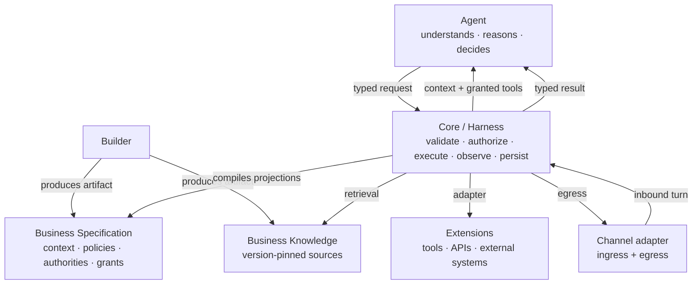
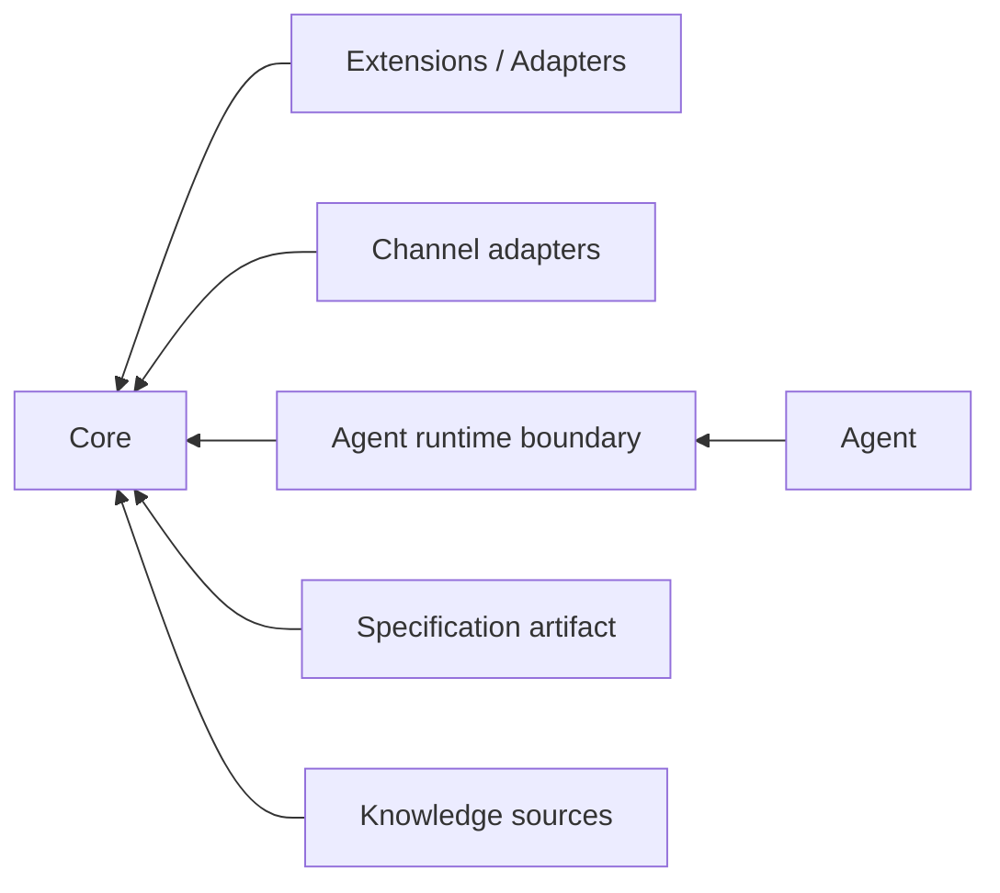
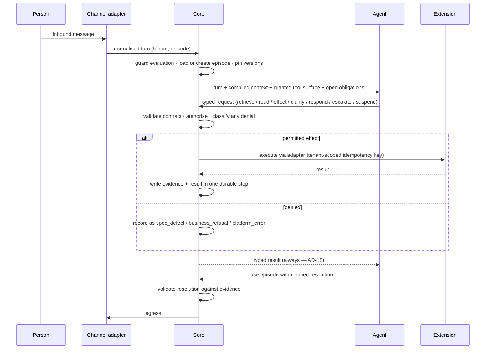

# Architecture Spine — Agent Studio

> **Amended after finalization (2026-10-16).** AD-26 to AD-29 were added to answer UX contract gaps 4, 5, 12 and 14 (EXPERIENCE.md, Amendments and Upstream Gaps). No earlier AD was rewritten; AD-18 carries one inline cross-reference. Their wording was approved by the user; the decisions remain PROPOSED under program gate D14. Decision trail in `.memlog.md`.

## Design Paradigm

**Hexagonal agent harness.** A model-in-charge agent decides what to do next; a deterministic Core decides what the agent is permitted to do, executes it, and records what happened. Everything outside the Core is reached through ports and adapters.

This is the conventional 2026 agent shape — a model-driven tool-use loop inside a harness, with authorization at a policy enforcement point — and no orchestration mechanism is invented beyond it.

| Layer | Namespace | Owns |
| --- | --- | --- |
| **Agent** | `agent/` | Understanding, reasoning, deciding the next step, adapting to unenumerated situations |
| **Core** | `core/` | Runtime, state, memory, capability exposure, validation, authorization, guardrails, execution, evidence, evaluation hooks, persistence |
| **Specification** | `spec/` | The business's declared context, policies, authorities, capability grants and outcome expectations |
| **Knowledge** | `knowledge/` | Version-pinned authoritative business material and retrieval over it |
| **Extensions** | `extensions/` | Tools, APIs, external systems, external knowledge — behind adapters |
| **Builder** | `builder/` | Conversation and sources → specification + knowledge artifacts → validation → promotion |

## Invariants & Rules

### AD-1 — The Agent decides; the Core constrains `[ADOPTED]`

- **Binds:** all
- **Prevents:** the Core accreting planning responsibility until the product is a workflow engine with a model attached
- **Rule:** The Core never selects the Agent's next step. No deterministic next-action selection, no primitive precedence table, no business transition graph, no business state machine, no workflow language, no precondition-derived orchestration standing in for agent decision-making. Before adding any mechanism, apply the test: *does this constrain the Agent, or decide its next step?*

### AD-2 — Every agent request crosses the Core, under a closed taxonomy

- **Binds:** Agent, Core, Extensions
- **Prevents:** an agent reaching an external system directly; a request kind that is neither authorized nor journaled; new request kinds appearing per business
- **Rule:** The Agent never contacts anything outside the Core. It emits one of a closed set of request kinds — `retrieve`, `read`, `effect`, `clarify`, `respond`, `escalate`, `suspend` — and **every kind is authorized and journaled, reads included**. An `effect` whose contract requires confirmation is not authorized until that confirmation is recorded. Adding a request kind is platform evolution (AD-15), never business configuration.

### AD-3 — Prompt constraints are advisory; Core constraints are binding

- **Binds:** Agent, Core, Specification
- **Prevents:** safety and authority depending on the model choosing to comply
- **Rule:** Any constraint that must hold is enforced by the Core. The specification may also describe it to the Agent, but no enforcement path may rely on the model respecting what it was told.

### AD-4 — One specification, many projections, compiled by the Core

- **Binds:** Specification, Agent, Core, Builder
- **Prevents:** the Agent believing it may do what the Core will refuse — a promise made to a customer and then broken, which is worse than a refusal
- **Rule:** The agent's context, the tool surface offered to the model, and the policy the Core enforces are **projections compiled from one specification artifact by the Core**. The Builder produces the artifact and never compiles projections. The compiler version is pinned into the episode alongside the specification version. A capability the Agent can see but policy will always deny is a defect.

### AD-5 — Denials are classified; only divergence is a defect

- **Binds:** Core, Specification, evaluation
- **Prevents:** correct business refusals polluting the defect signal, and genuine specification errors never surfacing
- **Rule:** Every denial is recorded as exactly one of `spec_defect` (the projections led the Agent to believe it was permitted), `business_refusal` (policy correctly denied), or `platform_error`. Only `spec_defect` enters the specification backlog. The divergence log is the specification's error signal and needs no human transcript review.

### AD-6 — Evidence is produced by the Core, typed, never claimed by the Agent

- **Binds:** Core, Agent, evaluation
- **Prevents:** an agent asserting that something happened when it did not; evidence that cannot be queried or asserted over
- **Rule:** Only the Core's execution record may attest that an effect occurred; the Agent cannot author evidence. Evidence entries are **typed records against a platform-owned schema**, never opaque blobs. A resolution asserting an effect without a corresponding Core execution record is invalid.

### AD-7 — Authoritative claims carry Core-attested provenance

- **Binds:** Agent, Core, Knowledge, Specification
- **Prevents:** a model inventing a source, version or locator that resolves trivially — attesting existence rather than provenance — and overclaiming a guarantee the field cannot deliver
- **Rule:** Every piece of authoritative business context the Core supplies carries a **Core-issued provenance reference**, bound to `(tenant, source, source version, locator)` and valid only for the issuing episode. Where the source is the Business Specification, that version **is** the one pinned into the episode at start (AD-11); a reference naming any other version is invalid. Authoritative sources include recorded retrieval results, the version-pinned Business Specification projection, and any other source the specification declares authoritative. A business-authoritative claim is valid only if it names a provenance reference the Core issued to this episode: **the Agent can neither mint, alter nor infer one**, and a claim naming an unissued, altered, or cross-tenant reference is refused before it reaches the person. General domain knowledge may come from the model, must be marked as such in evidence, and is enabled or disabled per business. Semantic faithfulness beyond provenance validity is **evaluated against a threshold, never guaranteed**.

### AD-8 — Knowledge is reached through the Core

- **Binds:** Agent, Core, Knowledge
- **Prevents:** unrecorded retrievals, and grounding claims that cannot be reconstructed
- **Rule:** The Agent decides *when* to retrieve; it never retrieves directly. Pinning is at **source-version granularity**, and every provenance reference carries its source version.

### AD-9 — The Core knows contracts, never vendors

- **Binds:** Core, Extensions
- **Prevents:** vendor logic migrating into the Core
- **Rule:** Dependencies point inward: extensions, adapters and the agent runtime depend on Core contracts; the Core depends on none of them. No vendor name, vendor branch, or vendor-specific key appears in Core or Agent code. An external system is reached only as *Core contract → adapter → extension*.

### AD-10 — The Core issues tenant-scoped idempotency keys

- **Binds:** Core, Extensions
- **Prevents:** duplicate real-world effects on retry, and — worse — a key colliding across businesses so that a genuine effect is silently suppressed as a duplicate
- **Rule:** External effects are at-least-once. **The Core issues the idempotency key, scoped by tenant and episode**; the adapter honours it. An action whose contract cannot define one is not eligible for automatic retry.

### AD-11 — Versions are pinned into the episode at start

- **Binds:** Core, Specification, Knowledge, evaluation
- **Prevents:** an episode resuming days later under changed rules; evaluation comparing episodes judged by different contracts
- **Rule:** An episode captures its specification version, compiler version and knowledge-source versions at creation, and reads them from episode state thereafter, never live.

### AD-12 — The loop reads nothing un-journaled, and steps carry no behavioural meaning

- **Binds:** Core, Agent runtime
- **Prevents:** episodes that cannot be recovered after a process failure; and durability decomposition being mistaken for a control graph
- **Rule:** Clock, randomness, identifiers, environment and configuration are obtained through recorded steps or pinned at episode start. Each model decision, authorized execution and evidence write is a durable step. **Step boundaries are a durability concern only — nothing may read the step sequence as a permitted order.**

### AD-13 — The episode is the unit of state, with one writer

- **Binds:** Core, evaluation, Extensions, Channel adapters
- **Prevents:** divergent notions of "a conversation"; two units writing the same state; results arriving after close corrupting a resolution
- **Rule:** One episode has one identity, one tenant, one lifecycle (`active` / `pending` awaiting a named external input / `closed`), one evidence record, and one join key where it touches an external system of record. **The Core is the sole writer of episode state.** It creates episodes on an adapter's request; concurrent inbound messages on one episode are serialized; a result arriving after close is recorded as a late result and never mutates the resolution. Cross-episode memory is out of scope.

### AD-14 — The Agent runtime sits behind a boundary we own

- **Binds:** Agent, Core
- **Prevents:** the product becoming an artifact of whichever agent framework was chosen
- **Rule:** Provider and framework abstractions live behind a runtime boundary defined by this platform. No framework type and no provider type crosses into Core, Specification or Extension code. Changing the model, provider or agent framework must not alter the business agent architecture. Model tiering across capability classes is expressible at this boundary.

### AD-15 — Capability evolution is platform work, not business configuration

- **Binds:** Core, Specification, Extensions
- **Prevents:** businesses silently redefining platform semantics
- **Rule:** Business configuration never changes Core semantics. Extensions add capability behind stable interfaces. A genuinely new semantic capability is a platform evolution, performed once in the Core.

### AD-16 — Channel is an adapter

- **Binds:** Core, Agent, Channel adapters
- **Prevents:** channel assumptions spreading into behaviour
- **Rule:** The Agent and Core never learn which channel an episode is on. A channel adapter provides both ingress and egress (AD-22). One channel ships first; its adapter is replaceable without touching behaviour.

### AD-17 — Tenant identity is a first-class key

- **Binds:** all
- **Prevents:** a citation resolving against another business's source; idempotency keys colliding across businesses; a second business silently sharing the first's state
- **Rule:** Every episode, specification, knowledge source, provenance reference, idempotency key, evidence record and action request carries a tenant identity. **Any resolution that crosses tenants is rejected, not filtered.**

### AD-18 — The Core has exactly two exits

- **Binds:** Core, Agent, every Core mechanism
- **Prevents:** a mechanism acquiring next-step authority through an undefined rejection path
- **Rule:** Every Core mechanism declares a **closed outcome vocabulary**. Every outcome returns control to the Agent as a typed result, except a declared **safety halt**, which terminates the episode with a recorded outcome. No Core mechanism routes control anywhere else, chooses what follows a refusal, or selects a next step. *[2026-10-16: an operator suspension is a trigger of the declared safety halt — AD-26]*

### AD-19 — Goals and obligations are Core-held typed state

- **Binds:** Core, Agent, Specification, evaluation
- **Prevents:** obligation gating implemented as prompt text, which AD-3 makes advisory only
- **Rule:** The goals in play for an episode and the obligations outstanding for each are **typed Core state** — readable by the Agent, asserted by the Core at resolution. They are never only prompt text. Holding them is not deciding with them: the Core never selects which goal is pursued or what to do about an unmet obligation.

### AD-20 — The resolution envelope is fixed; only its vocabulary is deferred

- **Binds:** Core, evaluation, Specification
- **Prevents:** four business builds inventing four resolution vocabularies, making evaluation unshareable
- **Rule:** Every resolution carries: which declared goal it concerns, whether that goal was served, under which authority, the evidence supporting it, and a business-defined payload. The **enumeration** of resolution kinds is deferred; the **envelope** is not.

### AD-21 — A guard's detection may be model-based; its verdict is binding

- **Binds:** Core, Agent
- **Prevents:** claiming determinism the mechanism cannot deliver, and guards quietly becoming a next-step selector
- **Rule:** Guard conditions may be evaluated by a model — urgency, policy violation and unsupported-request detection over free text cannot be deterministic. The **verdict is enforced deterministically** and its outcomes are closed: return a typed constraint to the Agent, or trigger a declared safety halt. A guard never composes a reply and never chooses the Agent's next step.

### AD-22 — Egress exists; initiation does not

- **Binds:** Core, Channel adapters
- **Prevents:** a `pending` episode that can never be delivered; and the platform cold-contacting people on its own initiative
- **Rule:** An episode is **initiated or resumed only by an inbound interaction or an external system event**. Within an episode so initiated, the Core may emit messages through a channel adapter's **egress port**. **The platform never independently initiates an outbound conversation or episode.**

### AD-23 — Specification promotion is versioned and gated

- **Binds:** Builder, Core, Specification
- **Prevents:** unreviewed behaviour change, and having no way back
- **Rule:** A specification version is immutable once promoted. Promotion requires its validation suite to pass — **a hard gate, not advice**. Rollback is selecting an earlier version. In-flight episodes keep the version pinned at their start (AD-11).

### AD-24 — Credentials never cross into Core or Agent

- **Binds:** Core, Agent, Extensions
- **Prevents:** secrets spreading through state, evidence or a model prompt
- **Rule:** Adapter credentials are held at the adapter boundary and resolved per tenant. No credential value appears in Core state, episode evidence, agent context or any prompt.

### AD-25 — The platform must support per-business data lifecycle requirements

- **Binds:** Core, Specification, operations
- **Prevents:** an evidence store whose shape makes per-business retention and deletion impossible to retrofit, given that episodes may hold sensitive and health-adjacent material
- **Rule:** Episode evidence must be storable such that per-business data lifecycle requirements *can* be honoured — addressable and removable by tenant, by episode and by age, without reshaping the evidence schema. The concrete retention policy, the deletion executor and their implementation are **deferred** to the infrastructure and data-handling epic; this AD fixes only that the architecture must not foreclose them.

### AD-26 — Each deployed Agent has one operator-controlled suspension state `[ADDED 2026-10-16 · PROPOSED]`

- **Binds:** Core, Channel adapters, operator surface
- **Prevents:** a suspend that fails silently or lapses on restart; a suspended Agent leaving a person mid-conversation in silence
- **Rule:** Each deployed Agent has exactly one suspension state — not suspended, effects suspended, or suspended — which is durable, scoped to that Agent, and changed only by a recorded, attributable operator action, resume included. The Core enforces it on every request. The Core reads the state as a recorded step (AD-12). Under *effects suspended*, every `effect` is refused as a typed result classified `business_refusal` (AD-5), and replies continue. Under *suspended*, each episode in flight — active or pending — ends in a declared safety halt (AD-18) whose recorded reason is the operator's suspension, so the business's terminal notice is emitted; for an episode mid-turn, a request already authorized completes and its evidence stands, and the halt applies at its next request to the Core. A terminal notice that cannot be delivered is recorded as undelivered, and the halt stands. An inbound message or external system event that would start an episode while the Agent is suspended is recorded as an episode that closes without an Agent turn and without a reply, with the recorded outcome *arrived while suspended*; it never reaches the Agent, so it is not a Core exit (AD-18), it carries no resolution (AD-20), and it is never answered after resume. Such episodes stay in the operational record and are outside the denominator of Agent-quality evaluation; every report of those measures states the exclusion and the number excluded. Mailbox connection status is reported by the channel adapter and is not part of this state.

### AD-27 — Specification versions have four states, derived from records `[ADDED 2026-10-16 · PROPOSED]`

- **Binds:** Builder, Core, Specification, operator surface
- **Prevents:** approving a version that failed validation; two live versions; a state field that drifts from what the records show
- **Rule:** A specification version is exactly one of draft, validated, approved or live, derived from its records and never stored as a free field. Only a version whose validation suite passed can be approved; only an approved version can be promoted. Each Agent has at most one live version. A version replaced as live stays approved, keeps its promotion history, and remains eligible for rollback (AD-23).

### AD-28 — A specification reference names its item `[ADDED 2026-10-16 · PROPOSED]`

- **Binds:** Core, Specification, operator surface
- **Prevents:** an interaction view that can quote source material but not the specification rule a reply relied on
- **Rule:** Within the specification projection, a provenance reference's locator (AD-7) names the expression area and the item.

### AD-29 — Received time and display label are stored uninterpreted `[ADDED 2026-10-16 · PROPOSED]`

- **Binds:** Core, Channel adapters
- **Prevents:** channel semantics leaking into episode state through an interaction label
- **Rule:** A normalised inbound turn may carry the received time (UTC) and a channel-neutral display label supplied by the channel adapter. The Core stores both uninterpreted and never reasons on them; they carry no channel semantics (AD-16) and are removable with the evidence (AD-25).

*Dependency direction: inward only — every arrow points at the Core, and the Core points at nothing. The Core reads the specification and knowledge as data; it does not depend on the units that produce them.*

## Runtime Interaction

Guard evaluation runs before the Agent turn; its verdict returns a typed constraint to the Agent, or halts the episode. Resolution validation runs when the Agent claims an episode is finished: a claimed outcome unsupported by evidence is refused and returned to the Agent as a typed result. Neither mechanism chooses the Agent's next step, and neither has any exit but those two.

## Consistency Conventions

| Concern | Convention |
| --- | --- |
| Naming | Capabilities are verb-first (`check_availability`); specification fields use business vocabulary; `episode` is the only word for a unit of interaction |
| Data & formats | Every record carries a tenant identity; action contracts declare input schema, effects, authority required, confirmation requirement, success evidence and idempotency scope; external correlation is an explicit join key; timestamps UTC |
| State & cross-cutting | Episode state mutated only by the Core, through recorded steps; errors cross boundaries as typed results, never as defaults; evidence vocabulary follows OpenTelemetry GenAI naming where it exists; configuration constructed once at the entry point |
| Specification authoring | Vocabulary borrowed from existing agent-manifest practice (autonomy level, boundaries, risk profile) rather than coined. The term "AgentSpec" is avoided — it collides with two unrelated projects. **The specification artifact may not contain ordering or sequencing constructs; the compiler rejects them.** |

## Stack

**Seed, verified against primary sources 2026-10-08.** The code owns this once it exists. Model and provider are deliberately unpinned — see AD-14.

| Name | Version |
| --- | --- |
| Python | 3.12+ *(conservative floor; 3.15 ships 2026-10-09)* |
| Agent runtime *(candidate, behind AD-14)* | Pydantic AI 2.54.0 *(verified 2026-10-08; vendor policy exempts OTel span-attribute changes from "breaking")* |
| Durability *(shortlisted, not committed)* | DBOS *(co-commit requires the evidence store and application store to be the **same** Postgres database)* |
| Capability transport | MCP, spec revision 2026-07-28 *(verified current 2026-10-08)* |
| Evidence vocabulary | OpenTelemetry GenAI conventions *(Development stability; moved to `semantic-conventions-genai` 2026-06-12 in v1.42.0, still no tagged release — expect churn)* |
| Store | PostgreSQL 16+ |

## Platform-Owned vs Business-Configurable

| Platform-owned (invariant) | Business-configurable |
| --- | --- |
| The agent loop and its runtime boundary | Identity, context, terminology, communication preferences |
| The request taxonomy and capability contracts | Which capabilities are granted |
| Authorization enforcement and denial classification | Authority boundaries, confirmation requirements |
| Guard mechanism and verdict enforcement | Which guard conditions apply |
| Goal and obligation state | Which goals exist and what obligations attach |
| Rule and predicate evaluation | The rules and predicates themselves |
| Evidence schema and production | Expected outcomes and the resolution payload |
| Retrieval mechanism and provenance issuance | Authoritative sources and their precedence |
| Episode lifecycle, durability, tenancy | Escalation conditions, data lifecycle requirements |
| Evaluation mechanism | Evaluation criteria |
| The generic guardrail set: do not invent business facts · do not act outside declared authority · do not perform undeclared actions · do not claim success without evidence · escalate when required authority or evidence is unavailable | Domain safety packs, as optional extensions |

## Deterministic vs Delegated

| Deterministic (Core) | Delegated (Agent) |
| --- | --- |
| Contract validation | What the person is trying to accomplish |
| Authorization of every request, and denial classification | What information is still needed |
| Guard **verdict** enforcement *(detection may be model-based — AD-21)* | When to retrieve |
| Rule and predicate evaluation | Which capability to use |
| Idempotency and retry | Whether to act, continue, respond — **and whether to escalate** |
| Evidence production | How to phrase anything |
| Provenance issuance and claim validity | How to handle a situation nobody enumerated |
| Resolution validation against evidence *(provisional — see Deferred)* | — |
| Episode lifecycle, serialization, durability | — |

Escalation has exactly one owner: **the Agent escalates.** The platform's guardrail obligation is to *refuse and return a typed result* stating that required authority or evidence is unavailable; it never escalates on the Agent's behalf.

## Deferred

| Deferred | Why it can wait |
| --- | --- |
| Resolution **vocabulary** (the enumeration of kinds) | The envelope is fixed by AD-20; the enumeration follows from running real episodes |
| Policy engine technology (OPA, Cedar, purpose-built) | AD-2 and AD-18 fix *where* and *how* authorization happens; the engine is selectable once real policy requirements exist |
| Durability engine selection | Semantics fixed. Fallback floor: Postgres with a unique constraint on `(tenant, episode, step, idempotency key)` and evidence written in the same transaction |
| Model routing and tiering policy | An evaluation question. The architecture must express tiering; the policy is measured, not designed |
| Retrieval architecture | Grounding, provenance and version-pinning are required; hybrid versus dense versus deterministic lookup is not an invariant |
| V1 channel | Behaviour is channel-independent by AD-16 and AD-22 |
| Long-term memory semantics | Out of scope by AD-13 |
| Tenancy deployment model (shared runtime, per-tenant workers, per-tenant deployment) | AD-17 makes tenancy correct at the data level regardless of topology |
| Marketplace and extension distribution | The adapter contract is the invariant; distribution is later product work |
| **The concrete specification schema** | Its invariants are fixed — one artifact compiled by the Core (AD-4), goals and obligations as typed state (AD-19), the resolution envelope (AD-20), immutable gated versions (AD-23), and no ordering constructs. The field-level schema belongs to the Specification and Builder epics |
| **Context assembly** | What sits permanently in agent context versus what is fetched on demand is a latency and quality tuning question, bounded by AD-7 (all authoritative context carries provenance) and AD-3. Measured, not designed up front |
| **Retention policy, deletion executor and data-lifecycle implementation** | AD-25 fixes that the evidence store must not foreclose per-business retention and deletion. The concrete policy, the executor and their implementation belong to the infrastructure and data-handling epic — deferred deliberately, not dropped |
| **Inline resolution validation as a shipped mechanism** | Assertion-based evaluation is standard offline; enforcing it inline at episode close is **our own extension**, provisional everywhere it appears, and to be validated by the proof gate before being relied upon |

## Proof Gate

Before the whole runtime is committed to this architecture, one realistic business interaction is implemented end to end — multi-turn reasoning, retrieval, at least one tool call, business policy enforcement, an external side effect, verification and evidence, and escalation — and compared against the existing LangGraph implementation on architectural simplicity, amount of custom code, number of model calls, latency, control and observability, failure handling, extensibility to a second business, and ease of enforcing business boundaries.

The existing 15-node LangGraph system is the reference implementation and migration source, not the foundation. It is neither preserved because it exists nor replaced to avoid it.

**Litmus test for the whole architecture:** can a new business be onboarded without generating a business-specific execution graph or state machine, while the Agent still reasons about situations nobody enumerated? Yes means an agent platform. No means a workflow engine with a model attached.
